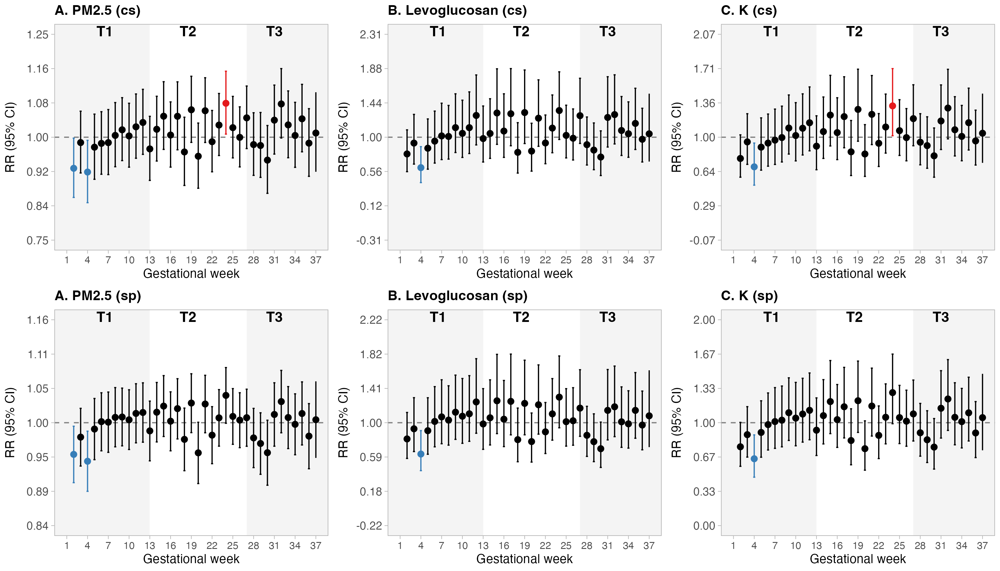
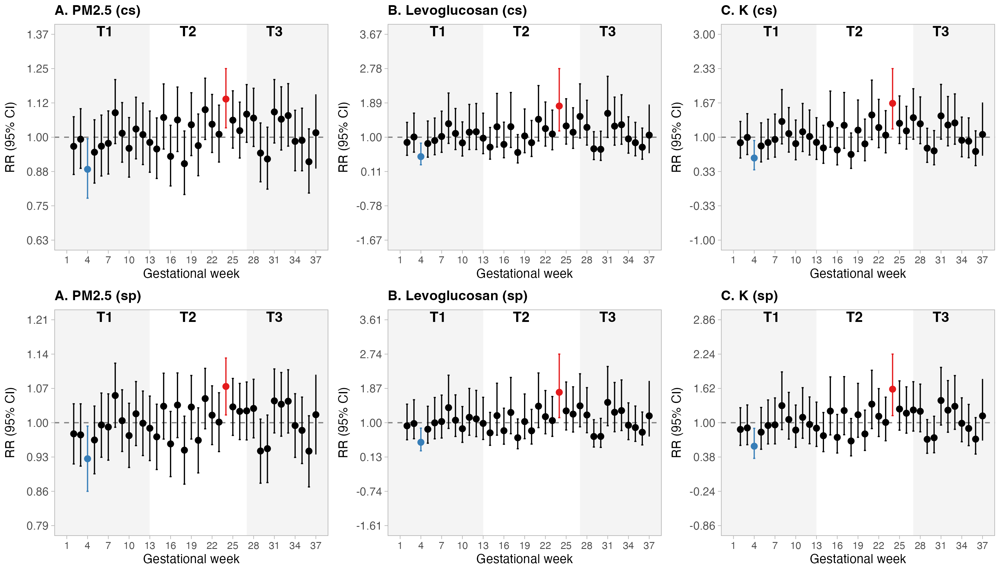

# Exposure to air pollution during pregnancy and congenital malformations in Temuco, Chile, a city heavily impacted by wood burning


## Funding

**FONDECYT Nº 11240322**: Climate change and urban health: how air pollution, temperature, and city structure relate to preterm birth (and related work on air pollution and newborn health).

Additional support: **Center for Climate and Resilience Research (CR²)**, Chile.

## Research team

**Estela Blanco** (estela.blanco@uc.cl), **Principal Investigator / Corresponding Author**

**José Daniel Conejeros** (jdconejeros@uc.cl), **Research Assistant / Repository Manager**

**Research collaborators**: Carlos Kilchemmann, Ismael Bravo, María Elisa Quinteros-Cáceres, Salvador Ayala, Ximena Ossa, Maribel Muñoz, Pablo Ruiz-Rudolph

**Affiliations**

1. College UC and Escuela de Salud Pública, Pontificia Universidad Católica de Chile, Santiago, Chile.  
2. Center for Climate and Resilience Research (CR²), Chile.  
3. Doctorado en Salud Ambiental y Biomedicina and Escuela de Obstetricia y Puericultura, Universidad Mayor, Chile.  
4. ISI Foundation, Turin, Italy.  
5. Departamento de Salud Pública, Facultad de Ciencias de la Salud, Universidad de Talca, Talca, Chile.  
6. Centro de Epidemiología y Políticas de Salud, Facultad de Medicina Clínica Alemana, Universidad del Desarrollo, Santiago, Chile.  
7. Departamento de Salud Pública and Centro de Excelencia CIGES, Universidad de la Frontera, Temuco, Chile.  
8. Departamento de Pediatría y Cirugía Infantil, Universidad de La Frontera, Temuco, Chile.

Author order and superscripts as in `Paper/Main text_Wood smoke and congenital malformations_R1_27102026.docx`.

## Publication

*Under revision (R1, 27 October 2026).* Manuscript and supplement: `Paper/`.

## Project overview

### Background

Exposure to air pollutants has been associated with congenital malformations, a leading cause of infant mortality in the first year of life. In southern Chile, residential wood burning drives critical winter pollution. The Temuco and Padre Las Casas conurbation combines high biomass-related exposure, social inequality, and detailed hospital and exposure records (2009-2016).

### Objective

To evaluate associations between gestational exposure to PM<sub>2.5</sub>, levoglucosan (levo), and water-soluble potassium (K<sub>sol</sub>) and congenital malformations, including congenital heart disease, using temporal (fixed site) and land-use regression (LUR) exposure models.

### Methods (as reported in the manuscript)

* **Design**: Retrospective cohort, Temuco Regional Hospital births to mothers residing in the urban conurbation (2009-2016).
* **Outcomes**: Any congenital malformation requiring hospitalization; congenital heart disease (secondary).
* **Exposure**: Weekly gestational histories; **temporal (cs)** and **LUR (sp)** models for PM<sub>2.5</sub>, levo, and K<sub>sol</sub>. Trimesters: weeks **1-12**, **13-26**, **27 until birth**; preconception: **12 weeks (pct1)**.
* **Main trimester models**: Multivariable models for OR/RR by trimester (PM<sub>2.5</sub> per 10 µg/m³; levo and K per IQR); mutually adjusted trimester specifications and preconception extensions in supplement (Tables 3-4, main text; see `Code/5.4`, `Code/5.5`).
* **Primary distributed lag models (Figures 2-3)**: For each gestational week, logistic regression with that week’s exposure and an inverse-distance-weighted summary of prior weeks (`Code/6.1`). No multiplicity correction across weekly tests; supplementary cohort DLNM and AIC/BIC comparison (`Code/7.0`).

### Key findings (main text, R1)

* **N = 15,452** births; **267 (1.7%)** with any congenital malformation; **128** congenital heart disease cases.
* High pregnancy exposures; LUR estimates exceed temporal (fixed site) estimates (Results; Supplementary Table 4).
* Trimester-average models: limited evidence for any malformation; increased levo/K and heart disease in third trimester under temporal assignment (Table 4).
* Weekly DLMs: peaks around **gestational week 24** for PM<sub>2.5</sub> and K (any malformation, temporal model) and for all three pollutants (heart disease); see Figures 2-3 and Supplementary Tables 5-8.

## Additional analyses in this repository (not in the main manuscript)

| Topic | Scripts | Outputs (examples) |
|--------|---------|---------------------|
| Exposure boxplots by sample and period | `4.1` | `Output/Exposure_boxplot.png` |
| UpSet plot of malformation types | `4.3` | `Output/Upset_malformation.png` |
| Exposure window scatter plots | `4.1` | `Output/Scatter_correlations_exposure_cs.png`, `..._sp.png` |
| Sex-stratified trimester models | `5.3`, `5.6` | `Output/Tables/Table_*_sex_*.xlsx` |
| IQR-scaled trimester models (non-div10) | `5.1` | `Output/Tables/Table_IQR_adjusted_malf*.xlsx` |
| DLM with 12-week preconception timeline | `6.2`, `6.3` | `Output/DLM/PCT/*`, `Malf_DLM_summary_DLM.xlsx` (pct sheets) |
| Cohort DLNM (4 cross-basis specs) | `7.0` | `Output/SUP/Malf_DLNM_SUP_*` |
| Sex × malformation chi-square diagnostics | `4.3` | `Output/Descriptive_sex_malformation_chi_square.xlsx` |

## R code structure

### Setup (`Code/0.x`)

* `0.1 Settings.R`: global settings  
* `0.2 Packages.R`: package installation and loading  
* `0.3 Funciones.R`: custom functions (trimester windows, helpers)  

### LUR and exposure prediction (`Code/1.0`-`3.1`)

* `1.0 Preparation_LUR_Data.R`  
* `2.0 Check_LUR .R` *(filename contains a space)*  
* `3.0 Predict_LUR_malf_sample_models.R`  
* `3.1 Predict_LUR_full_sample_models.R`  

### Malformation data and descriptives (`Code/4.x`)

* `4.0 Join_Full_Malf_Data.R`: join cohort and exposure; `Descriptive_exposure_tables_malf.xlsx`  
* `4.1 Descriptive_figure_exposure.R`: boxplot, correlation Table 2 source, scatter figures  
* `4.2 Full_data_compilation.R`  
* `4.3 Descriptive_tables.R`: Table 1, UpSet, sex chi-square export  

### Exposure-outcome models, main text Tables 3-4 (`Code/5.x`)

* `5.0 Exposure_Models_Malf.R`  
* `5.1 Exposure_Models_Malf_IQR.R`  
* `5.3 Exposure_Models_Malf_IQR_by_sex.R`  
* `5.4 Exposure_Models_Malf_10.R`: PM<sub>2.5</sub>/10 + raw levo/K (manuscript scaling)  
* `5.5 Table_models_10.R`: **`Table_div10_adjusted_malf.xlsx`**, **`Table_div10_adjusted_malf_card.xlsx`**  
* `5.6 Exposure_Models_Malf_10_by_sex.R`  

### Distributed lag models (`Code/6.x`, `7.0`)

* `6.0 DLM_malf_prototype.R`  
* `6.1 DLM_malf_full_models_IQR.R`: **Figures 2-3**, `Malf_DLM_results_all_models_IQR.xlsx`  
* `6.2 DLM_malf_pct_full_models_IQR.R`: preconception extended DLMs (**Supplementary Figures S1-S2**)  
* `6.3 DLM_malf_summary_excel.R`: **`Malf_DLM_summary_DLM.xlsx`** (Supplementary Tables S5-S12 layout)  
* `7.0 DLM_suplementary.R`: cohort DLNM, **Supplementary Tables S13-S14** (AIC/BIC)  

## Manuscript figures and tables (R1, 27 October 2026)

Source documents: `Paper/Main text_Wood smoke and congenital malformations_R1_27102026.docx`, `Paper/Supplementary_Wood smoke and congenital malformations_R1_27102026.docx`.

### Figure 1. Study area and birth locations

Geographic panels for Temuco and Padre Las Casas and spatial distribution of births (2009-2016). **Prepared for publication in the manuscript** (not exported from this pipeline).

### Table 1. Sample description

Comparisons of infants with and without congenital malformation and with congenital heart disease.

* **Repository**: `Output/Descriptive_table_malformation.xlsx`  
* **Script**: `Code/4.3 Descriptive_tables.R`  

### Table 2. Summary statistics and correlations between trimester-average exposures

Pearson correlations and median (IQR) by period (pct1, T1-T3), pollutant, and exposure type.

* **Repository**: `Output/Correlation_exposure_table.xlsx` (sheet `Summary_statistics_correlations`)  
* **Script**: `Code/4.1 Descriptive_figure_exposure.R`  

### Table 3. Risk of congenital malformation by trimester exposure

Adjusted models; temporal (cs) and LUR (sp); single-period and mutually adjusted sheets.

* **Repository**: `Output/Tables/Table_div10_adjusted_malf.xlsx` (sheets `Table 2`, `Mutual t1+t2+t3`, `Mutual pct1+t1+t2+t3`, `Footnote`)  
* **Scripts**: `Code/5.4`, `Code/5.5`  

### Table 4. Risk of congenital heart malformation by trimester exposure

Same structure as Table 3.

* **Repository**: `Output/Tables/Table_div10_adjusted_malf_card.xlsx`  
* **Scripts**: `Code/5.4`, `Code/5.5`  

### Figure 2. Weekly DLM, any congenital malformation

Temporal (cs) and LUR (sp) panels; PM<sub>2.5</sub>, levo, K.

* **Repository**: `Output/DLM/Malf_DLM_IQR_trimester_panel_malf.png`  
* **Script**: `Code/6.1 DLM_malf_full_models_IQR.R`  



### Figure 3. Weekly DLM, congenital heart disease

* **Repository**: `Output/DLM/Malf_DLM_IQR_trimester_panel_malf_card_bin.png`  
* **Script**: `Code/6.1`  



### Supplementary material (reported in `Supplementary_Wood smoke and congenital malformations_R1_27102026.docx`)

| Item | Content | Repository output | Script |
|------|---------|-------------------|--------|
| Table S1 | Median (IQR) exposure by period, **temporal model** | Derived from `Output/Descriptive_exposure_tables_malf.xlsx` (filter `tipo == cs`) | `4.0`, `4.1` |
| Table S2 | Median (IQR) exposure by period, **LUR model** | Same file (filter `tipo == sp`) | `4.0`, `4.1` |
| Table S3 | Malformation types and counts | Manuscript table; co-occurrence figure `Output/Upset_malformation.png` | `4.3` |
| Table S4 | Median (IQR) by period, outcome group, and exposure type | `Descriptive_exposure_tables_malf.xlsx` | `4.0` |
| Tables S5-S6 | Weekly DLM, any malformation (cs / sp) | `Malf_DLM_summary_DLM.xlsx` sheets `malf_cs_gest`, `malf_sp_gest`; raw `Malf_DLM_results_all_models_IQR.xlsx` | `6.1`, `6.3` |
| Tables S7-S8 | Weekly DLM, heart disease (cs / sp) | Sheets `malf_card_cs_gest`, `malf_card_sp_gest` | `6.1`, `6.3` |
| Figure S1 | DLM including preconception, any malformation | `Output/DLM/PCT/Malf_DLM_IQR_PCT_panel_malf.png` | `6.2` |
| Figure S2 | DLM including preconception, heart disease | `Output/DLM/PCT/Malf_DLM_IQR_PCT_panel_malf_card_bin.png` | `6.2` |
| Tables S9-S12 | Preconception-inclusive weekly DLM | `Malf_DLM_summary_DLM.xlsx` sheets `*_pct`; `Malf_DLM_results_PCT_models_IQR.xlsx` | `6.2`, `6.3` |
| Table S13 | AIC/BIC, DLNM vs primary DLM, **any malformation** | `Output/SUP/Malf_DLNM_SUP_model_fit_AIC_BIC_paper.xlsx` (rows: Outcome = any malformation) | `7.0` |
| Table S14 | AIC/BIC, **congenital heart disease** | Same file (rows: congenital heart disease) | `7.0` |

Supplementary DLNM trimester panels (four specifications): `Output/SUP/Malf_DLNM_SUP_{spec}_trimester_panel_{outcome}.png` (`7.0`).

### Repository-only figures (not numbered in the main PDF)

* `Output/Exposure_boxplot.png` (`4.1`)  
* `Output/Scatter_correlations_exposure_cs.png`, `Output/Scatter_correlations_exposure_sp.png` (`4.1`)  
* `Output/Upset_malformation.png` (supports Supplementary Table S3 narrative)  

## Data availability

### Analysis datasets (generated in this pipeline)

Processed objects are written to `Output/` (e.g. `Data_malf_exposure_wide.RData`, `Data_malf_exposure_long.RData`, `base_final.RData`). **Individual-level hospital records are not committed** (see `.gitignore`).

### Data access

**Restricted access.** Requests may be submitted to the study team. Aggregated results and analysis code are provided here where possible.

## Reproducibility

### System requirements

* R ≥ 4.0.0  
* Packages via `Code/0.2 Packages.R`, including: `rio`, `data.table`, `tidyverse`, `writexl`, `dlnm`, `ggpubr`, `ragg`, `UpSetR`, `future`, `furrr`, and others as loaded in scripts  

### Running the analysis

1. **Setup**

   ```r
   source("Code/0.1 Settings.R")
   source("Code/0.2 Packages.R")
   source("Code/0.3 Funciones.R")
   ```

2. **Data and exposure pipeline**: `1.0` → `3.1` → `4.0` → `4.2`  

3. **Descriptives (Tables 1-2, Figure 1 not automated)**: `4.1`, `4.3`  

4. **Main trimester models (Tables 3-4)**: `5.4` → `5.5`  

5. **Primary DLMs (Figures 2-3; Supp. Tables S5-S8)**: `6.1` → `6.3`  

6. **Preconception DLMs (Supp. Figures S1-S2; Tables S9-S12)**: `6.2` → `6.3`  

7. **Supplementary DLNM (Tables S13-S14)**: `7.0`  

Runtime is longest for `6.x` and `7.0` depending on hardware and parallel settings.

## Repository structure

```
Pollution_Malformation_TEM/
├── Code/                         # Analysis scripts (0.x through 7.0)
├── Output/                       # Generated tables, figures, .RData
│   ├── DLM/                      # Primary weekly DLM (Figures 2-3)
│   ├── DLM/PCT/                  # Preconception DLMs (Supp. Figures S1-S2)
│   ├── SUP/                      # Supplementary DLNM and AIC/BIC tables
│   ├── Models/                   # Saved GLM objects and model lists
│   └── Tables/                   # Manuscript Tables 3-4 exports
├── Paper/                        # Manuscript R1 (not modified by pipeline)
│   ├── Main text_Wood smoke and congenital malformations_R1_27102026.docx
│   ├── Supplementary_Wood smoke and congenital malformations_R1_27102026.docx
│   └── Response to reviewers_R1_27102026.docx
├── Input/                        # Not tracked (see .gitignore)
├── Ref/                          # Not tracked (see .gitignore)
├── LICENSE
└── README.md
```

## Important notes

### Data privacy

Individual-level clinical records are confidential and cannot be shared publicly.

### Geographic context

Temuco-Padre Las Casas winter pollution is dominated by residential wood burning. Levoglucosan and water-soluble potassium trace fresh biomass smoke alongside PM<sub>2.5</sub>.

### Citation

If you use this code or methodology, please cite the manuscript when available:

> Blanco, E., Kilchemmann, C., Conejeros, J.D., Bravo, I., Quinteros-Cáceres, M.E., Ayala, S., Ossa, X., Muñoz, M., Ruiz-Rudolph, P. Exposure to air pollution during pregnancy and congenital malformations in Temuco, Chile, a city heavily impacted by wood burning. *Under revision*. 2026.

## Contact

**Estela Blanco**: estela.blanco@uc.cl  

**José Daniel Conejeros**: jdconejeros@uc.cl  

For data access, contact the corresponding author.

## License

This project is licensed under the MIT License. See [LICENSE](LICENSE).

## Acknowledgments

E.B. acknowledges **FONDECYT Nº 11240322** and the **Center for Climate and Resilience Research (CR²)**.

## Conflicts of interest

The authors declare no conflicts of interest.

## CRediT authorship contribution statement

Guidance: [Elsevier CRediT author statement](https://www.elsevier.com/researcher/author/policies-and-guidelines/credit-author-statement).

| Author | Contribution |
|--------|---------------|
| Estela Blanco | Conceptualization, methodology, software, validation, resources, supervision, writing (original draft) |
| Carlos Kilchemmann | Conceptualization, methodology, writing (review and editing), writing (original draft) |
| Ismael Bravo | Methodology, software, validation, formal analysis, data curation, writing (review and editing), visualization |
| José Daniel Conejeros | Methodology, software, validation, formal analysis, data curation, writing (review and editing), visualization |
| María Elisa Quinteros-Cáceres | Writing (review and editing) |
| Salvador Ayala | Writing (review and editing) |
| Ximena Ossa | Writing (review and editing) |
| Maribel Muñoz | *To be updated* |
| Pablo Ruiz-Rudolph | Methodology, software, resources, writing (review and editing) |
